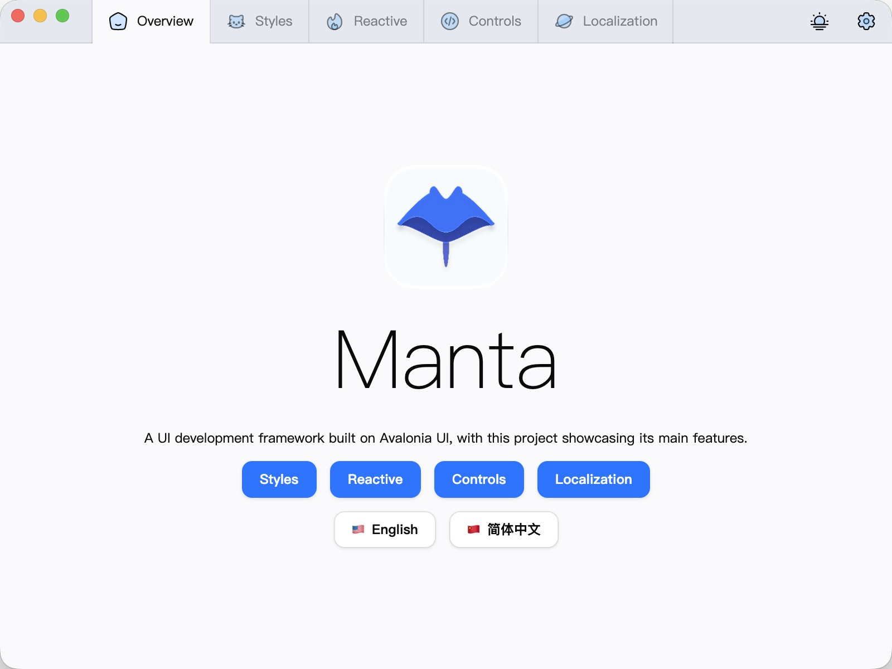

<p align="center">
  
</p>

# Manta

[English](README.md) | **简体中文**

Manta 是一个基于 Avalonia 的跨平台桌面应用 UI 工具包和 MVVM 框架，提供可主题化的控件、显式的 MVVM 运行时和编译时代码生成。



## 功能特性

- 以 `M` 为前缀的完整控件集，以及受支持 Avalonia 控件的主题化样式。
- 基于 OKLch 色彩空间的亮色与暗色主题。
- MVVM 层的 `Model`、`ViewModel`、`WindowModel` 和 `DialogModel` 基类。
- 基于特性的视图注册，在编译时生成视图创建代码。
- 完整支持 Native AOT 与裁剪，视图和语言生成均不依赖反射。
- 通过 `RegionManager<T>` 实现区域与标签页导航。
- 通过 `DialogModel` 实现模态对话框。
- 由 YAML 文件生成的类型安全语言键。

## 安装

Manta 面向 .NET 10 和 Avalonia 12。包发布在 [NuGet.org](https://www.nuget.org/packages/ONEO.Manta) 上。

```sh
dotnet add package ONEO.Manta
dotnet add package ONEO.Manta.Generators
```

使用 `[View<T>]` 和语言键生成器时，请添加 `ONEO.Manta.Generators`。

## Native AOT

Manta 兼容 Native AOT 与裁剪。库以 `IsAotCompatible` 构建，其生成器装配视图与语言键时不依赖基于反射的发现。`MantaDemo` 在 Release 下使用 `PublishAot` 发布。

```xml
<PropertyGroup>
    <PublishAot>true</PublishAot>
    <PublishTrimmed>true</PublishTrimmed>
</PropertyGroup>
```

## 使用

创建应用入口并继承 `MApp`：

```csharp
using Avalonia;
using Manta;

static class Program
{
    [STAThread]
    public static void Main(string[] args)
    {
        MApp.Build<App>().StartWithClassicDesktopLifetime(args);
    }
}
```

在应用中注册主题和主窗口模型：

```xml
<MApp xmlns="https://github.com/avaloniaui"
      xmlns:x="http://schemas.microsoft.com/winfx/2006/xaml"
      x:Class="MyApp.App">
    <MApp.Styles>
        <MantaTheme />
    </MApp.Styles>
</MApp>
```

```csharp
sealed class App : MApp
{
    public override void Initialize() => AvaloniaXamlLoader.Load(this);

    protected override void OnInitialize(out MAppOptions options)
    {
        options = new() { MainModel = () => new Main_Model() };
    }
}
```

使用 `View` 特性将视图模型与视图配对。生成器会提供 `CreateView`，因此模型只需声明其绑定：

```csharp
[View<Main>]
sealed partial class Main_Model : WindowModel
{
}

sealed partial class Main : MView
{
    public Main() => InitializeComponent();
}
```

在扩展库之前，请阅读[架构概览](ARCHITECTURE.md)。

## 示例

[samples/](samples) 存放直接使用已发布包（而非 `source/` 下的项目）的独立应用。[MantaSample](samples/MantaSample) 演示了启动、MVVM、区域导航、对话框、本地化和常用控件。[MantaComponents](samples/MantaComponents) 是一个纯 Avalonia 应用，只引入 Manta 主题和控件，不使用 Manta 的 MVVM 运行时。[MantaThemeSample](samples/MantaThemeSample) 只使用 Manta 主题变量，不引入任何 Manta 控件或运行时。[AvaloniaI18nSample](samples/AvaloniaI18nSample) 则为标准 Avalonia 应用加上 Manta 多语言功能。

```sh
cd samples
dotnet run --project MantaSample
dotnet run --project MantaComponents
dotnet run --project MantaThemeSample
dotnet run --project AvaloniaI18nSample
```

## 文档

- [ARCHITECTURE.md](ARCHITECTURE.md) 说明各项目及其边界。
- [架构专题](ARCHITECTURE.md#subjects)深入讲解 MVVM 运行时、主题和本地化。
- [CHANGELOG.md](CHANGELOG.md) 列出面向用户的变更。

## 开发

安装 .NET 10 SDK。库与演示项目位于 `source/` 目录，请在其中的终端运行以下命令：

```sh
cd source
dotnet build Manta.slnx
dotnet run --project MantaDemo
```

编辑控件的 `Design.PreviewWith` 块或主题文件后，重新生成派生文件：

```sh
dotnet run --project MantaPrepare
```

推送 `v<major>.<minor>.<patch>` 标签即可发布：发布流程会将包推送到 NuGet.org 并创建 GitHub release，发布说明取自 [CHANGELOG.md](CHANGELOG.md) 中对应版本的条目。发布会使用 NuGet 可信发布：流程用 GitHub OIDC token 换取短期 API key，因此只需仓库密钥 `NUGET_USER`（你的 nuget.org 用户名），并在 nuget.org 上为 `release.yml` 配置一条可信发布策略。

贡献者规则见 [AGENTS.md](AGENTS.md)。

## 官网

官网位于 [website/](website)，使用 React Router 和 shadcn/ui 构建。[Website workflow](.github/workflows/website.yml) 会将其部署到 GitHub Pages。

```sh
cd website
bun install
bun run dev
```

构建与部署细节见 [website/README.md](website/README.md)。

## 许可证

Manta 基于 [MIT 许可证](LICENSE) 发布。
